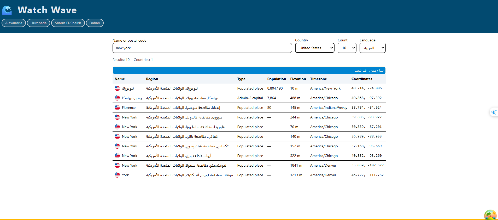

# Watch Wave 🌊

A React + TypeScript app for choosing a coastal location to check wave conditions. Search any place in the world (in Arabic, German or English), select it, and the whole app knows which location is active.

**Live demo:** [maboelmagd26.github.io/watch-wave](https://maboelmagd26.github.io/watch-wave/)

> **Status:** the location-picking half is complete. The marine forecast that consumes the selected location is the next milestone (see [Future Improvements](#9-future-improvements)).

---

## 1. Project Overview

Surfers, divers and sailors usually start from a few known spots (Alexandria, Hurghada, Sharm El-Sheikh, Dahab), but sometimes need a place that isn't on that list. Watch Wave covers both: quick preset buttons in the navbar, plus a full geocoding search with country, language and result-count filters.

The central design idea is that **location is the single input of the product**. Everything downstream (waves, wind, tides) will be a function of `selectedLocation.latitude / longitude`. The app-level `Location` type is deliberately the narrow shape a forecast request needs, so the forecast layer will never depend on geocoding details.

There is no account, no backend and no API key. Data comes from the free [Open-Meteo Geocoding API](https://open-meteo.com/en/docs/geocoding-api).

## 2. Screenshots



*Searching "new york", filtered to the United States, with results in Arabic. The banner is right-aligned because the language is Arabic.*

## 3. Features

- **Location search** across the world by name or postal code
- **Filters:** country, result count and language (Arabic, German, English)
- **Debounced input** (400 ms): fast typing sends one request, not one per keystroke
- **Request cancellation:** the previous in-flight request is aborted with `AbortSignal`
- **Caching:** results stay fresh for 1 hour and are kept for 24 hours. `"Alex"`, `"alex "` and `"ALEX"` share one cache entry
- **Coastal presets** in the navbar for one-click selection
- **Rich results table:** flag, region, type, population, elevation, timezone, coordinates
- **Selection feedback:** the banner shows `name, country`, and the matching row and preset are highlighted
- **RTL support:** the banner aligns right when the language is Arabic
- **Runtime validation** of every API response with Zod

## 4. Tech Stack

| Area              | Choice                                                                           |
| ----------------- | -------------------------------------------------------------------------------- |
| UI                | React 19, TypeScript                                                             |
| Build             | Vite                                                                             |
| Styling           | Tailwind CSS 4                                                                   |
| Server state      | TanStack Query 5 (with Devtools)                                                 |
| Validation        | Zod 4                                                                            |
| Data              | [Open-Meteo Geocoding API](https://open-meteo.com/en/docs/geocoding-api)        |

## 5. Getting Started

**Prerequisites:** Node.js 20+ and npm.

```bash
git clone <repo-url>
cd watch-wave
npm install
npm run dev      # start the dev server
```

Other scripts:

```bash
npm run build    # type-check + production build
npm run lint     # run ESLint
```

No environment variables or API keys are needed.

## 6. Architecture & State Management

### Where state lives

| State                                       | Lives in                       | Changed by                               | Effect                                                              |
| ------------------------------------------- | ------------------------------ | ---------------------------------------- | ------------------------------------------------------------------- |
| `selectedLocation`                          | `App`                          | Clicking a navbar preset or a result row | Highlights the preset and row; the banner shows the selection       |
| `query`, `count`, `countryCode`, `language` | `LocationDashboard`            | The filter inputs                        | Change the search request and the cache key                         |
| Debounced query                             | `useDebouncedValue`            | 400 ms after typing stops                | Only then does a request fire                                       |
| Search results                              | TanStack Query (`queryClient`) | Every completed request                  | Cached under `["geocoding", query, count, language, countryCode]`   |

**Design decisions**

- **Server state vs. UI state are separate.** TanStack Query owns everything that comes from the API; plain `useState` owns filter inputs and the selection. No global store is needed at this size.
- **State lives at the lowest common owner.** `selectedLocation` is in `App` because both the navbar and the dashboard need it; filters stay inside `LocationDashboard`.
- **The API layer is isolated.** [src/api/geocodingApi.ts](src/api/geocodingApi.ts) is the only file that touches the network, and [src/schemas/geocoding.schema.ts](src/schemas/geocoding.schema.ts) is the contract with the API.
- **`toLocation()` is the boundary** between the rich geocoding result and the narrow `Location` type ([src/types/location.ts](src/types/location.ts)) the rest of the app uses.
- **Cache policy is centralised** in [src/lib/queryClient.ts](src/lib/queryClient.ts).

## 7. Error Handling

| Failure                              | Behaviour                                                                                                         |
| ------------------------------------ | ----------------------------------------------------------------------------------------------------------------- |
| Query shorter than 2 characters      | No request is sent; a hint says "Type at least 2 characters." and old rows are cleared                            |
| No matches                           | The API omits `results`; the schema defaults it to `[]`, so the table is hidden and counters show 0               |
| API 4xx (bad parameter)              | `GeocodingError` carries the API's `reason`, shown in red. **Not retried**                                        |
| API 5xx / network down               | Retried up to 2 times with exponential back-off, then the error is shown                                          |
| API response shape changes           | Zod throws and the error is shown. **Not retried**                                                                |
| User keeps typing                    | The previous request is aborted; previous rows stay visible until new ones arrive                                 |
| Flag image fails to load             | Falls back to the alt text (country code)                                                                         |
| Rate limiting / outage of Open-Meteo | Surfaces as one of the errors above; there is no fallback provider                                                |

**Debugging aids:** React Query Devtools show every cache entry and its status, and the Network tab shows one `geocoding-api.open-meteo.com/v1/search` request per settled query (cancelled ones appear as `(canceled)`).

## 8. Known Limitations

- **No explicit "no results" message** yet; an empty result just hides the table.
- The selected row is matched by **name**, not `id`, so two places with the same name (e.g. "Springfield") both highlight.
- Preset cities use string ids (`"alex"`) while search results use numeric ids, so a preset and the same city from search are never treated as the same selection.
- The selection is held in memory only and **resets to Alexandria on reload**.
- **Not mobile-friendly:** the page has a hard `min-w-4xl`.
- The results table is click-only (no keyboard or screen-reader support yet).
- The footer is a placeholder.
- No automated tests yet (no test runner is configured).
- Flags are loaded from a third-party host.

## 9. Future Improvements

In rough priority order:

1. **Marine forecast:** call the Open-Meteo [Marine API](https://open-meteo.com/en/docs/marine-weather-api) with the selected `latitude`/`longitude` (wave height, period, direction, swell) through a `useMarineForecast(location)` hook that mirrors `useLocationSearch`. Same provider, no new key.
2. **Persist the selection** in localStorage or the URL so a reload or shared link opens the same spot.
3. **Proper empty, loading and error components** instead of inline text, plus an explicit "No places match" state.
4. **Select by `id`** instead of by name.
5. **Accessibility:** keyboard navigation for the results table and `aria-live` for the result counters.
6. **Favourites and recent searches** replacing the hard-coded presets.
7. **Tests:** unit tests for `searchLocations`, `shouldRetry` and `toLocation`, and a component test for the search → select flow.
8. **Responsive layout** and a real footer.

## 10. Project Structure

```
src/
  api/          geocodingApi.ts          network calls, error type, toLocation()
  schemas/      geocoding.schema.ts      Zod contract for the API
  hooks/        useLocationSearch.ts     debounced, cached search query
                useDebouncedValue.ts
  lib/          queryClient.ts           app-wide retry/caching defaults
  components/   Navbar, Filters, LocationDashboard
  constants/    locations.ts (presets), search.ts (countries, languages, counts)
  types/        location.ts              app-level Location type
  App.tsx       owns selectedLocation
  main.tsx      entry point, QueryClientProvider
```
